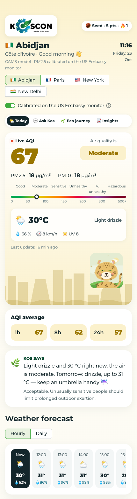
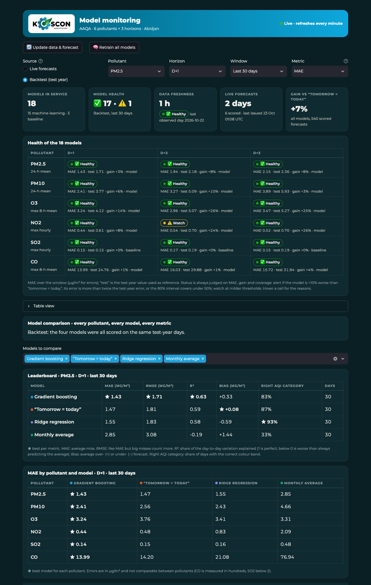
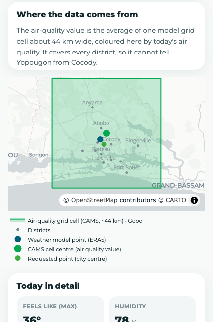

# AAQA — Abidjan Air Quality & Weather · powered by KOSCON

[](https://github.com/gikodaku/abidjan-air-quality-analysis/actions/workflows/ci.yml)

AAQA tracks the air in Abidjan. It downloads four years of pollution and weather data,
**forecasts six pollutants (PM2.5, PM10, ozone, NO2, SO2, CO) three days ahead** with machine
learning, and shows the result in two apps:

- a **public app** in the style of a mobile air-quality app: live AQI, weather, forecasts,
  health advice, an assistant called Kos, and an eco journey with points and badges;
- a **monitoring dashboard** for the team: the live accuracy and health of all 18 models.

<p align="center">
  
  &nbsp;&nbsp;
  
</p>

## How to run it

Every command is typed in a **terminal, inside the project folder** (the folder that contains
`README.md` and `Makefile`). In VS Code, *Terminal → New Terminal* opens there. You need
Python 3.11+ and an internet connection.

```bash
git clone https://github.com/gikodaku/abidjan-air-quality-analysis.git
cd abidjan-air-quality-analysis      # or: cd ~/git/AAQA if you already have it

make install    # first time only (about 2 min): creates .venv and installs everything
make all        # downloads the data, trains the 18 models, forecasts (about 4 min)
make app        # public app      → http://localhost:8501
make monitor    # monitoring      → http://localhost:8502  (in a second terminal)
```

Each app keeps running in its terminal; `Ctrl+C` stops it.

**Every day**, refresh the data and the forecast (about 1 min, no retraining):

```bash
make update
```

**Recommended: calibration on the US Embassy monitor.** Get a free key at
https://docs.airnowapi.org/ and put it in a `.env` file in the project folder:
`AIRNOW_API_KEY=your-key`. `make all` and `make update` then download the embassy's PM2.5 and
correct the model with it. The first download takes about 15 minutes.

**Optional: AI answers for Kos.** Kos works offline by default. To use Claude, set an Anthropic
API key in the terminal before `make app`:

```bash
export ANTHROPIC_API_KEY="your-key"      # Windows PowerShell: $env:ANTHROPIC_API_KEY="your-key"
```

| Other commands | What they do |
|---|---|
| `make api` | REST API → http://localhost:8000/docs |
| `make test` | test suite (no internet needed) |
| `make lint` | code style check |
| `make notebooks` | re-runs the analysis notebooks on the current data |
| `make clean` | deletes downloaded data and models (`make all` rebuilds them) |
| `docker compose up --build` | app (:8501), monitoring (:8502) and API (:8000) in Docker |

Without `make` (for example on Windows), from the project folder: `python -m venv .venv`, then
`.venv/bin/pip install -e ".[dev]"`, `.venv/bin/aaqa all` and
`.venv/bin/streamlit run dashboard/app.py` (use `.venv\Scripts\` on Windows).

## What you get

### Public app

- **🌤️ Today**
  - **Live AQI** for this hour, in its category colour, with the AQI scale and a marker.
  - PM2.5 and PM10, the current weather, the AQI average over 1, 8 and 24 hours.
  - **Kos the leopard**, the mascot. Its fur, health, scene and animation follow the AQI and the
    health advice: outdoors in the sun on good days, in a mask when one is advised, at home
    behind a window when people should stay in, and a zombie when the air is hazardous. All six
    states are in [docs/mascot/](docs/mascot/index.html) (`make mascot` rebuilds them).
  - **Other cities**: Paris, New York and New Delhi, with live CAMS values and the CAMS 3-day
    forecast. The AAQA models, history and calibration are for Abidjan.
  - The city's skyline (Abidjan's Plateau, the Eiffel Tower, the Empire State Building, India
    Gate), tinted by the air quality.
  - The weather for the next 24 hours or 4 days (switch), and the AAQA air-quality forecast for
    the next 3 days.
  - Particles and gases against the WHO guidelines, a **map of where the data is sampled**, and
    today's details.
- **💬 Ask Kos**: questions such as *What's the weather tomorrow?*, *Can I go running today?* or
  *What is NO2?*, answered from the live forecast.
- **🌱 Eco journey**
  - Points for each visit, a daily quiz, a daily eco-challenge that fits the weather, and
    questions to Kos.
  - Levels from Seed to Forest, a day streak and badges.
- **📈 Insights**: history and seasons of every pollutant, and the model accuracy.

A KOSCON loading page opens the app, and a "Powered by KOSCON" footer closes it; both follow the
brand guidelines.

### Monitoring dashboard

- **Live monitoring**: every forecast is logged and scored when the real value arrives.
- **Backtest**: the test year, for every model.
- **Health of the 18 models** (6 pollutants × 3 days ahead), each Healthy, Watch or Alert.
- **Model comparison**: gradient boosting, "tomorrow = today", Ridge and the monthly average,
  compared on **MAE, RMSE, R², bias and right AQI category**, per pollutant and day ahead.
- **Forecast vs observed** with the 80% range, rolling error, interval coverage.
- **Data drift** against the same season in past years, and the sampling map.
- Buttons to update the data or retrain the models.

## Results

### Measured: the US Embassy monitor (ground truth)

1,635 days of PM2.5 from the embassy's reference monitor (February 2020 → April 2025):

| PM2.5 (24-h mean) | Value |
|---|---|
| Average | **25.1 µg/m³, 5× the WHO annual guideline** (5 µg/m³) |
| Days above the WHO 24-h guideline (15 µg/m³) | **73%** |
| Harmattan (Dec–Feb) | **42.0 µg/m³ on average, 99% of days above the guideline** |
| Rainy season (Apr–Jul) | 18.2 µg/m³, 63% of days above the guideline |
| Days "Unhealthy for sensitive groups" or worse | 19% |
| Yearly average 2020 → 2025 | 25.7, 29.8, 22.4, 19.5, 27.8, 29.4: **no improvement** |

### Modelled: Copernicus CAMS (all six pollutants)

1,541 days (August 2022 → October 2026) of CAMS pollution and ERA5 weather. CAMS reads lower than
the monitor (see the next section); these figures are the uncorrected model.

| Pollutant (statistic) | Mean | Harmattan vs rainy season | Days above the WHO guideline |
|---|---|---|---|
| PM2.5 (24-h mean) | **14.1 µg/m³**, 2.8× the WHO annual guideline | 23.7 vs 11.1 | **31%** (64% in the harmattan) |
| PM10 (24-h mean) | **25.4 µg/m³**, 1.7× the WHO annual guideline | 45.3 vs 19.4 | **9%** (35% in the harmattan) |
| O3 (max 8-h mean) | 63.8 µg/m³ | 80.3 vs 59.6 | **2.7%** (12% in the harmattan) |
| NO2, SO2, CO | low in CAMS (NO2 underestimated, see below) | — | 0% |

The worst day in the model data was **8 February 2024** (PM2.5 126 µg/m³, PM10 211 µg/m³), during
a harmattan dust episode.

Forecasts are measured on 365 days never seen in training, against the "tomorrow = today"
baseline. The 18 models beat that baseline in 15 cases. For SO2 they don't in cross-validation,
so the baseline is served for SO2.

| Pollutant | D+1 MAE (µg/m³) | D+1 R² | Gain D+1 / D+2 / D+3 (test) | Gain (cross-validation) |
|---|---|---|---|---|
| PM2.5 | 1.70 | 0.70 | 6% / 13% / 14% | 3% / 5% / 7% |
| PM10 | 3.76 | 0.75 | 9% / 14% / 15% | 5% / 6% / 8% |
| O3 | 4.08 | 0.56 | 8% / 11% / 13% | 3% / 5% / 4% |
| NO2 | 0.61 | 0.32 | 10% / 25% / 25% | 1% / 8% / 16% |
| CO | 24.8 | 0.48 | 3% / 8% / 5% | 2% / 5% / 5% |

PM2.5 lands in the right AQI category 81% of the time at D+1 and 75% at D+3.

## Where the data comes from, and its limits



All pollution values come from the **Copernicus CAMS** global model, through
[Open-Meteo](https://open-meteo.com): one grid cell about 44 km wide, centred on 5.40° N,
4.00° W, that covers every district from Anyama to Port-Bouët. The weather comes from ERA5 and
the Open-Meteo forecast models.

Because the cell also averages lagoon, ocean and countryside, CAMS reads lower than measurements
in the city:

- **PM2.5 is calibrated on the US Embassy monitor.** Over 776 days where both exist, raw CAMS
  misses by 9.0 µg/m³ on average (bias −5.7). Calibrated, it misses by **6.9 µg/m³ (−24%)**,
  with a bias of −2.5, each month being corrected with what was learned before it. Today's
  calibrated value matches street-level services such as Google's air-quality map.
- **The gap grew in 2024.** CAMS was close to the monitor in 2022–2023 but has read about 2–3×
  lower since 2024, while the monitor shows no improvement. The drop in the model data is a
  model change, not cleaner air, which is why the correction learns from the most recent year.
- **The embassy monitor stopped reporting on 1 May 2025.** The correction learned until then is
  still applied; it can't be checked against new measurements.
- Other pollutants are not calibrated: NO2 from traffic is probably up to 6× too low, and ozone
  too high.

Details: [technical documentation](docs/technical_docs.md#limitations).

## Project structure

```
config/config.yaml        location, dates, pollutants, horizons, test period
src/aaqa/                 the Python package
  data/                   download (CAMS, ERA5, US Embassy), cleaning, live air, weather
  calibration.py          CAMS PM2.5 corrected on the US Embassy monitor
  features/               daily aggregation and features (no leakage from the future)
  models/                 training, baselines, model selection, predictor
  pollutants.py, aqi.py   pollutant definitions, WHO guidelines, US AQI
  monitoring.py           forecast log, scoring, health, model comparison, drift
  assistant.py            Kos (offline answers + optional Claude)
  gamification.py         points, levels, badges, quiz, eco-challenges
  api/                    REST API (FastAPI)
  pipeline.py, cli.py     the `aaqa` command: fetch → process → report → train → forecast
  cities.py               Abidjan (full pipeline), Paris, New York, New Delhi (CAMS forecast)
dashboard/                app.py (public app), monitoring.py, mascot (Kos the leopard), maps,
                          skylines, logo
docs/mascot/              gallery of the six mascot states (index.html + one SVG each)
scripts/                  build_mascot_gallery.py
notebooks/                exploration, features, modelling (executed, with results)
reports/                  figures, metrics, statistics, recommendations
tests/                    test suite on synthetic data
docs/                     user guide, technical documentation, screenshots
```

Data (`data/`), models (`models/`) and logs are not versioned: `make all` and `make update`
rebuild them.

## Documentation

- [User guide](docs/user_guide.md): running the apps, reading the index, the API, monitoring
- [Technical documentation](docs/technical_docs.md): data, method, evaluation, limitations
- [Recommendations for the authorities](reports/recommendations.md)
- [Developer guide](docs/developer_guide.md): architecture, adding a pollutant, keys, releases
- [Audit](docs/audit.md): state of the product, risks and next steps
- [Changelog](CHANGELOG.md)

## License

MIT, see [LICENSE](LICENSE). Data: Copernicus CAMS and ERA5 (Copernicus licence), distributed by
Open-Meteo (CC BY 4.0). Map tiles © OpenStreetMap contributors © CARTO.
